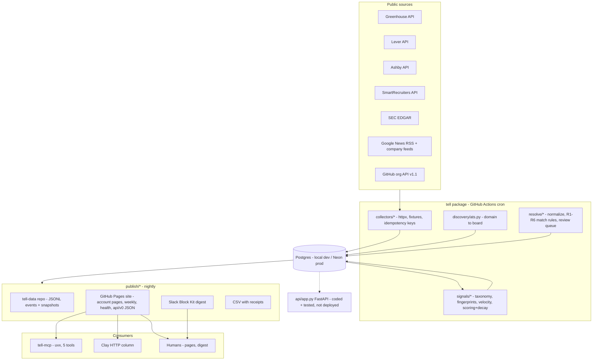

# Tell — 0-to-1 Open-Source Build Plan

Normative reference: `docs/SPEC.md` (the Build spec). Business context: the business plan, kept in the private repo at `tell-private/docs/BUSINESS_PLAN.md` (not published). Section numbers below (§) refer to the Build spec.

## Decisions locked (recorded in `docs/decisions/`)

- Repos under Karan's **personal GitHub account**: `tell`, `tell-data`, `tell-private`. Pages URL and `TELL_DATA_REPO` stay env-parametrized so nothing is hardcoded.
- Collectors built **fresh from the spec** (no scanner port).
- **Local-first**: local Postgres (Docker compose Postgres 16, or an existing local server) for dev/tests; one guided cutover milestone creates Neon, Slack webhook, SEC contact, PyPI, GitHub repos/secrets/Pages.
- **Workday and Oracle collectors dropped** (deviation from spec's flag-off default). Discovery still *detects* Workday/Oracle/Workable patterns and records them in `ats_boards` with `status='unsupported'` so coverage reporting ("we cannot see this one") stays honest; nothing ever polls them. `TELL_ENABLE_UNDOCUMENTED_ATS` is not created.
- **All optional code included** — FastAPI service, GitHub org collector, Streamlit review page — written and tested, but nothing deployed beyond GitHub Pages + Actions.
- License: **Apache-2.0** (deviation from spec default MIT; LICENSE, headers policy, `pyproject` classifier).
- Seed domains: **YC public directory only** (~5k); Karan's target list arrives later through the watchlist intake.
- PyPI: `tell-mcp` is available (verified). The main package keeps import name `tell` but is never published to PyPI, so the taken `tell` name doesn't matter.
- CI database: Postgres 16 **service container** in GitHub Actions (works on fork PRs, no secrets); Neon is production-only. `alembic upgrade head` runs against the container every CI run. (Simplification of the spec's scratch-Neon-branch step; recorded as a decision.)
- Gold set lives in `tell-private` per spec §6; a scrubbed 50-row public sample ships in `tests/fixtures/gold_sample.csv` so fork CI always runs the resolution tests; full 300-row gate runs on `main` after cutover via read-only deploy key.

## Architecture

## Phase 0 — Repo scaffold and toolchain

Create the `tell` repo structure exactly per §2 layout.

- `pyproject.toml`: uv-managed, `requires-python = ">=3.12"`, deps pinned: `httpx`, `pydantic` v2, `pydantic-settings`, `sqlalchemy`, `alembic`, `psycopg`, `rapidfuzz`, `tldextract`, `feedparser`, `lxml`, `jinja2`, `pyyaml`, `typer` (CLI); dev: `pytest`, `pytest-cov`, `respx`, `freezegun`, `ruff`, `mypy`, `pre-commit`, `gitleaks` hook, `pip-audit`. Per-package coverage floors (90 for `collectors/`, `resolve/`, `signals/`; 80 overall).
- `tell/config.py`: pydantic-settings; every env var from §2's table typed with defaults (`TELL_POLL_CONCURRENCY=8`, `TELL_RATE_EDGAR_RPS=5`, `TELL_RATE_NEWS_RPS=1`, …). `.env.example` lists all with comments; no values.
- `tell/http.py` (part of §2 tooling): one shared httpx client — 20s timeout, honours `Retry-After`, exponential backoff 1/2/4/8s, max 4 tries on 429/5xx, `TELL_HTTP_USER_AGENT` header, per-host rate budget helper.
- `tell/db.py`: engine/session factory, `SKIP LOCKED` claim helper, upsert helpers.
- `docker-compose.yml`: Postgres 16 for local dev/tests. `Makefile`: `make dev`, `make test`, `make refresh-fixtures`, `make migrate`.
- `CLAUDE.md` (§1 agent conventions), `docs/SPEC.md` (verbatim copy of the Build spec), `LICENSE` (Apache-2.0), `CHANGELOG.md`, `.pre-commit-config.yaml` (ruff, mypy, gitleaks), `.github/workflows/ci.yml` (full detail in Phase 10).
- Gate: `uv sync && make test` green; `ruff`, `mypy --strict tell/` pass.

## Phase 1 — Schema, migrations, event model

- `tell/models.py`: SQLAlchemy models matching §5 DDL **field for field**: `companies`, `company_aliases`, `ats_boards`, `postings`, `posting_observations`, `events`, `signals`, `scores`, `watchlists`, `watchlist_items`, `feedback`, `runs`, `review_queue` — including all indexes and unique constraints. `ats_boards.status` gains the `unsupported` value (Workday/Oracle/Workable detections).
- Alembic initial migration; CI applies it to scratch Postgres every run; one migration file per schema-touching PR thereafter.
- `collectors/base.py`: `Collector` protocol, `Event` dataclass (the §8 one-shape: `event_id = sha256(source|external_id|version)`, `occurred_at` vs `observed_at`, `magnitude`, `url`, `payload` JSONB, `raw_ref`, `run_id`), upsert-on-natural-key write path, `runs` row lifecycle, one JSON log line per run (§1 format).
- Idempotency rules as code + tests (§5): rerun inserts zero rows; `job_updated` vs `job_opened` keying; `job_closed` only after two consecutive polls ≥12h apart; `D/A` amendments update the original `form_d_filed` payload and never create a second funding signal.
- PII guard tests (§12): no column named `email`/`phone`/`first_name`/`last_name` in any model; no `@` in fixtures outside URLs.
- Gate: `alembic upgrade head` idempotent; model-vs-DDL parity test passes.

## Phase 2 — Documented ATS collectors (Greenhouse, Lever, Ashby, SmartRecruiters)

One PR each, per §3.1–3.4, each shipping: collector, pydantic response models (the contract), fixtures (`normal`, `empty_board`, `drift` — hand-trimmed <50 KB, scrubbed), contract test, idempotency test, and `docs/sources/<source>.md` (endpoint, rate limit, legal note, sample).

- Greenhouse: `boards-api.greenhouse.io/v1/boards/{token}/jobs?content=true`; decode double-encoded `content`; key `greenhouse:{token}:{id}:{updated_at}`; poll each board ≤ every 6h.
- Lever: `api.lever.co/v0/postings/{site}?mode=json` + EU host variant; key `lever:{site}:{id}:{createdAt}`.
- Ashby: `api.ashbyhq.com/posting-api/job-board/{name}?includeCompensation=true`; key `ashby:{name}:{id}:{publishedAt}`.
- SmartRecruiters: paginated `/v1/companies/{id}/postings`; detail call only for new ids; key per §3.4.
- Posting state machine shared in base: upsert `postings`, append `posting_observations` per poll, emit `job_opened`/`job_updated`/`job_closed` per §5 rules.
- Fixtures recorded once via `make refresh-fixtures` against real public boards (polite rates), then frozen; CI never touches the network (`respx` everywhere).
- Gate (maps to §16 M1): run any collector twice on its fixture → second run `inserted: 0`; drift fixture fails the contract test naming the missing field.

## Phase 3 — ATS discovery and YC seed

- `discovery/ats.py` per §4: fetch `/careers`, `/jobs`, `/join`, `/company/careers`, homepage (first 200 wins, ≤2 redirects, robots.txt honoured); scan HTML/iframes/scripts for all vendor URL patterns (including Workday/Oracle/Workable → recorded `unsupported`); slug-guess fallback (`acme`, `acmeinc`, `acme-inc`) with confidence 0.6 vs 0.95 for page hits; fuzzy-verify board ownership at ratio ≥85 else review queue; write `ats_boards` with `discovered_from`, `confidence`, `last_verified_at`; re-verify every 30 days and after two consecutive 404s.
- `tell discover --domain acme.com` CLI + batch mode with the §11 budget (≤300 new domains/run, 4 rps).
- YC directory seeder: pull the public YC company directory (domain + batch) into `companies` (~5k rows); documented in `docs/sources/yc-directory.md`.
- Gate: discovery finds boards for ≥7 of 10 sample companies; misses logged `no_board` with pages checked (coverage is reportable).

## Phase 4 — EDGAR, News, GitHub collectors

- `collectors/edgar.py` (§3.6): daily index `form.{YYYYMMDD}.idx` filtered to `D`, `D/A`, `8-K`, `S-1`; Form D `primary_doc.xml` parsed with `lxml` into the §3.6 field list; **never store `relatedPersonsList`** (PII guard test covers this); 8-K items 5.02/1.01/2.01 flagged; CIK→ticker map; amendments attach by `fileNumber`; key `edgar:{accession_number}`; 5 rps with declared `SEC_USER_AGENT`; quarterly Form D TSV loader for backtest backfill (13.2).
- `collectors/news.py` (§3.7): Google News RSS per company (`when:7d`), company feed discovery (`<link rel=alternate>` then `/feed`, `/rss`, `/blog/rss.xml`, `/blog/feed`); title-regex classification (funding / launch / leadership / expansion); store title+URL+pubDate+source+matched-regex only, never article text; 1 rps, 6h cache, block = slow down not retry; key `news:{sha256(url)}`; §11 rotation (active-in-30d companies + watchlist members nightly, long tail weekly).
- `collectors/github_org.py` (§3.8, config-gated per-company via `companies.github_org`): org repos + releases, conditional requests (`If-None-Match`), keys per spec.
- Each ships fixtures (normal/empty/drift), contract + idempotency tests, `docs/sources/*.md` with legal notes.
- Gate: Form D fixture parses to exact amounts; amendment fixture updates, never duplicates; news classifier unit-tested on a labelled title set.

## Phase 5 — Entity resolution

- `resolve/normalize.py`: the 5-step §6 normalization (NFKC, legal-suffix stripping incl. the `labs`-only-when-preceded rule, punctuation, `the`, digit spelling, `tech→technologies`, `tldextract` domain label).
- `resolve/match.py`: rules R1–R6 top-to-bottom with exact confidences (0.98 / 0.95 / 0.90 / 0.85 / 0.60 / 0); every decision logs `{rule, ratio, candidates[:5]}` into the event payload; Form D `issuerPreviousNameList` becomes aliases on link (renamed companies keep history); unlinked events kept with `company_id` null.
- `resolve/review.py`: CSV round-trip (export open `review_queue` items, re-import verdicts) **and** the Streamlit page (link / create company / reject buttons; password-gated; resolved items write an alias so pairs never return). CSV is the default workflow; Streamlit is in-repo, not deployed.
- Gold set: 300 companies (domain, legal name, CIK when any, board identifier) drafted from the YC directory + EDGAR full-text verification, delivered to Karan for spot-checking, stored in `tell-private/gold/companies.csv`; scrubbed 50-row sample in the public repo for fork CI.
- `tests/test_resolve.py`: precision/recall over the gold set with positive+negative cases per rule.
- Gate (§6): precision ≥ 0.97, recall ≥ 0.85; numbers go into the README verbatim; review queue target <20 open items/week once live.

## Phase 6 — Taxonomy, fingerprints, reposts, velocity

- `signals/taxonomy.py`: the 10 role families with ordered keyword lists exactly per §7 (first match wins; `sales engineer`→`sales`; `exec` only when nothing else matched; `intern`/`contract` tagged `is_intern` and excluded; non-English → `other`).
- Requisition fingerprint: `sha1(title_norm|department_norm|location_norm|remote_flag)` with seniority-token stripping; same fingerprint on one board within 30 days = one requisition.
- Repost detection: closed-within-30d fingerprint reappearing → `repost_of` + `job_reposted` (not `job_opened`); changed `external_id` with identical fingerprint + `content_hash` within 7d = repost.
- Stale handling: >90 days open → weight 0.25 and listed under "long-open roles"; >180 days → excluded; `ghost_votes` counter stored, inert until 500 votes.
- `signals/velocity.py`: `new7`, `base` (four non-overlapping 7d windows over `(t-35d, t-7d]`, floor 0.5), fire on `new7≥3 ∧ ratio≥1.5` or `new7≥2` for sales/gtm_ops/customer at <50 open postings; `magnitude = min(new7, 10)`; receipt = board URL + counted postings list.
- Tech keywords: table in `docs/methods/tech-keywords.md`; first-ever appearance per company emits `tech_mentioned_first_time` (weight 0 in default profile).
- `tests/test_velocity.py`: the 60-labelled-title family test (60/60), repost, stale, baseline-floor cases; `freezegun` throughout.
- `docs/methods/hiring-velocity.md` with definitions; measured numbers filled after soak.

## Phase 7 — Signals, profiles, scoring

- `signals/scoring.py` per §8: signal rows created from events (types, magnitudes — funding `log10(totalOfferingAmount)` capped 8, undisclosed→6); `contribution()` with per-type half-life, zero beyond 4 half-lives; `score()` = exact sum; stored in `scores.contributions` JSONB with `{signal_id, contribution, url, occurred_at}`.
- ICP profiles as YAML (§8 schema): `default` and `job-seeker` ship in-repo; partner profiles later in `tell-private/profiles/`. Family-aware `hiring_velocity` weighting (1.0 target families / 0.3 others), `size_band` filter.
- Heat = percentile rank within a watchlist, shown beside the raw sum.
- `tell score --profile X --as-of D`: recompute, write `scores`, emit `score_crossed_threshold` (default 6.0, upward, last-day, with hysteresis).
- `tests/test_scoring.py`: all six §8 explainability tests (sum to 1e-9; monotone decay; exact half-life; no orphan contributions — every one traces to an event with a URL; profile isolation; threshold hysteresis ≤1 alert per 7d for ±0.5 oscillation).
- Feedback loop plumbing: `feedback` verdict→label mapping and the weekly precision-by-signal-type report command (weights stay hand-tuned until ≥300 labels).

## Phase 8 — Publish: tell-data, site, Slack, CSV, weekly, health

- `tell-data` repo generator per §9 layout: `events/YYYY/MM/DD.jsonl` (append-only, the system of record; also the >180d archive target for DB pruning), `postings/snapshots/` (90-day retention), `site/` as Pages root.
- `publish/site.py`: Jinja templates for `index.html`, `companies/{domain}.html` (score+heat, contribution bars with receipts, counted postings expanded, long-open roles grey, "why not higher" decayed-signals footer, thumbs row → prefilled Google Form), `weekly/{ISO-week}.html` (top-25 sales-hiring velocity across the whole monitored set, top-25 new Form D by amount, method-change line, coverage numbers), `health.html`.
- Static JSON API: `api/v0/companies/{domain}.json` matching §9's contract exactly; `api/v0/weekly/latest.json`, `api/v0/watchlists/{slug}.json` (public watchlists only), `api/v0/health.json`. JSON Schema at `docs/api/company.schema.json`; generator validates every file pre-push.
- `publish/slack.py`: Block Kit digest per §9 (header, context line with freshness p95, ≤10 crossed accounts with receipts + "Why now", footer), 1.1s sleep between sends, fires only on the 08:00-local run.
- `publish/csv_export.py`: the exact §9 column list including `coverage_note` and `rate_this_row`.
- `tests/test_publish.py`: every JSON validates against the schema; every contribution has a URL; no unresolved template variables; site size budget respected (prune pages for companies signal-less 180d).
- Gate (§16 M2/M3): contributions on an account page sum to the score by calculator; JSON validates in CI.

## Phase 9 — CLI, MCP server, FastAPI (coded, not deployed)

- `tell/cli.py` (typer): `ingest --source X [--board Y]`, `discover`, `resolve`, `score --all-profiles`, `publish --out`, `notify --slack`, `deadman`, `runlog [--week]`, `weekly`, `backtest <name>`, `prune` (posting_observations >90d, events >180d → JSONL archive per §5 size budget).
- `tell/mcp/server.py` → packaged as `tell-mcp` (separate distribution in the same repo, `uvx tell-mcp`): official Python MCP SDK, stdio; tools `watch_accounts` (returns prefilled intake-form link in v0), `in_market`, `explain`, `events`, `coverage` (reads the static Pages JSON via `TELL_BASE_URL`, optional `TELL_API_KEY` for later FastAPI); `why_now_email` MCP prompt; tool descriptions instruct citing receipt URLs. Tested against recorded JSON locally; Claude Desktop / Cursor config snippet in README.
- `tell/api/app.py` FastAPI per §10 v1: `GET /v1/companies/{domain}`, `/v1/in-market`, `/v1/companies/{domain}/events`, `POST /v1/watchlists`, `POST /v1/feedback`; `api_keys` table (SHA-256 at rest, `tell_` + 32 random bytes) + `api_usage` metering/quota — **new alembic migration**; full test coverage; `Dockerfile`/render notes in docs, deployment deferred until a consumer needs it.

## Phase 10 — Workflows, run-health, security CI

- `ci.yml`: PR + push to main; `uv sync --frozen`, `ruff check` + `ruff format --check`, `mypy --strict tell`, `pytest -q --cov=tell --cov-fail-under=80` (per-package 90 floors), Postgres 16 service container + `alembic upgrade head`, `gitleaks`; weekly `pip-audit` job.
- `ingest.yml` per §11 YAML verbatim minus Workday/Oracle: cron `17 2,8,14,20 * * *`, `workflow_dispatch` with `source` input, `concurrency: ingest`, matrix `[greenhouse, lever, ashby, smartrecruiters]` with `fail-fast: false`, `filings` job (edgar + news), `resolve_score_publish` with `if: always()`, tell-data checkout via `TELL_DATA_PUSH_TOKEN`, commit/push (the daily commit that keeps schedules alive past GitHub's 60-day cutoff), `notify --slack`, `deadman` (red run + free GitHub failure email when any source silent 24h).
- `weekly.yml`: Mon `23 6 * * 1` — weekly page, `backtest --refresh`, methods publish, private-channel summary.
- Run-health: every collector writes `runs` rows; `health.json`/`health.html` rebuilt each run (`last_ok_at`, `success_rate_7d`, `fetched_24h`, `inserted_24h`, `freshness_p95_h`); `tell runlog --week` prints the ops line.
- Discovery budget inside the ATS job (≤300 new domains/run, 4 rps); run-time estimates per §11 (ATS legs <4 min/vendor at 8 concurrent).

## Phase 11 — Backtest commands and methods reports

Each is `tell backtest <name>` writing a dated Markdown report to `docs/methods/` with question, cohort, N, query, numbers, caveats (N<30 → flagged, never resume-quotable):

- `speed-vs-press` (13.1): Form D cohort last 90d, Google News `when:120d` funding-regex matches, `alert_at` computed from index-appearance + 6h cadence; the §13.1 SQL ships as the implementation.
- `velocity-lead` (13.2): retrospective now (current `posted_at` reconstruction + Wayback CDX for boards that have snapshots, labelled with coverage caveats; quarterly Form D TSVs for the window), prospective harness ready to run after 60 days of collection with the open-posting-decile control group.
- `noise` (13.3): repost share by vendor/family, median posting lifetime, >180d board share.
- `ops` (13.4): weeks unattended, success rate, freshness p95, companies/postings counts, gold-set precision/recall + live review-queue rate.
- `dogfood` (13.5): private, keyed to `karan-targets` watchlist + `job-seeker` profile; metrics stay in `tell-private`.

Real numbers require calendar soak time after cutover — the commands, queries, and report templates are complete now; the reports regenerate via `weekly.yml`.

## Phase 12 — Docs, README, launch assets, intake

- `README.md` per §15.5 outline (Apache-2.0, quickstart `uvx tell-mcp` 3-liner + `git clone && uv sync && tell ingest --source greenhouse --board <token>`, Mermaid architecture, per-source legal notes linking `docs/sources/`, methods links, health badge, "writing a collector" guide with the `Collector` protocol + PR checklist, limitations, roadmap).
- `docs/sources/*.md` complete for all shipped sources; `docs/decisions/*` for every deviation above; `CONTRIBUTING.md` with §1 PR rules; `.github/PULL_REQUEST_TEMPLATE.md` with the standing checklist; issue template for "watch these domains".
- Launch asset drafts in `docs/launch/` with bracketed numbers wired to named report lines (never shipped as brackets): 50-domains DM + delivery message (§15.1–15.2), LinkedIn post (§15.3), Show HN (§15.4). Posting is Karan's; the drafts regenerate their numbers from the methods reports.
- Intake: Google Form field spec (§15.6) + the nightly reader job that ingests the published-CSV sheet into `tell-private` watchlists.

## Phase 13 — Guided cutover (Karan + agent, step by step)

Karan's actions, with instructions at each step; nothing here is needed before this phase:

1. Install `gh` CLI, authenticate; create `tell` (public), `tell-data` (public, Pages enabled on `site/`), `tell-private` (private); push.
2. Neon free project → `DATABASE_URL` Actions secret; run `alembic upgrade head`; seed YC directory; supervised first discovery pass (spread over days per the 300/run budget).
3. Fine-grained PAT (contents:write, tell-data only) → `TELL_DATA_PUSH_TOKEN`; read-only deploy key for `tell-private`.
4. Slack incoming webhook → `SLACK_WEBHOOK_URL`; pick the SEC contact email → `SEC_USER_AGENT`.
5. PyPI account + trusted publishing for `tell-mcp`; tag-triggered publish workflow.
6. First supervised `ingest.yml` runs; verify health page, digest, account pages against live boards (§16 M1/M2 hand-checks).
7. Then the unattended soak begins — the M2–M4 sign-offs (digest two mornings untouched, reports with real N, README quickstart on a clean machine) are calendar-bound and happen after this build completes.

## Acceptance (maps to spec §16)

- M1: double-run `inserted: 0`; 10 random postings match live pages; discovery ≥7/10; drift fixtures fail CI loudly; zero PII anywhere.
- M2: Form D linker 9/10 with the 10th in review queue; funding URLs open sec.gov with matching amounts; contributions sum by calculator; digest received two mornings; report 13.1 exists with N + caveats.
- M3: `api/v0/companies/<domain>.json` valid with URLs on every contribution; `tell-mcp` in Claude Desktop answers "which of these ten domains are in market and why" with citations; Clay table of 20 domains fills; dead-man turns a run red when a source is paused.
- M4: reports published and dated; README quickstart <5 min on a clean machine; weekly page real and linked; every launch-draft number traces to a report line; legal notes linked.

## Build order and sizing

Phases 0→12 are sequential-ish with 2/3/4 parallelizable after 1, and 11/12 after 8. Everything is code-complete and CI-green locally before cutover; the long pole is fixture recording (live, polite, supervised) and the gold set. The spec's week-based milestones compress: code in one continuous build, then cutover, then calendar soak for the unattended-operation gates.

## Local build conventions (added by the orchestrator)

- Repo root on this machine: `/Users/karankapur/Desktop/Tell/tell`. Sibling folders `/Users/karankapur/Desktop/Tell/tell-data` and `/Users/karankapur/Desktop/Tell/tell-private` are generated locally and become their own repos at cutover.
- Local database: Homebrew PostgreSQL 14 at `postgresql+psycopg://karankapur@localhost:5432/tell_dev` (dev) — tests create and drop their own temporary database per session on the same server. `docker-compose.yml` with Postgres 16 ships for contributors without a local server. CI uses a Postgres 16 service container.
- Parallel agents work in the same checkout. Each phase owns disjoint files; shared files (`pyproject.toml`, `uv.lock`, `tell/cli.py`, `tell/models.py`, alembic migrations) are edited only by the phase that owns them in the plan. Dependencies are pinned up front in Phase 0 so later phases never touch `pyproject.toml`; a phase that truly needs a new dependency reports it instead of adding it.
- Contract and idempotency tests discover collectors automatically (each collector module exposes a `COLLECTOR` object; see `tell/collectors/base.py`), so adding a source never edits a shared test file.
